# আকাশনীড় · Akashnir

**A voiceless cinematic short documentary about a rooftop garden for birds in Dhaka.**

3:54 · 1920×1080 · 24 fps · 2.39:1 widescreen · Bangla on-screen text · no narration

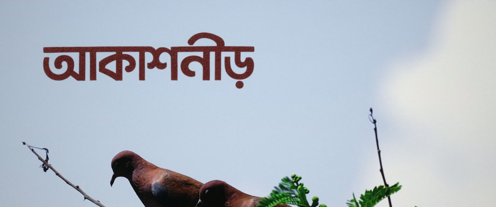

Dhaka is one of the most crowded cities on earth: traffic, smog, a tired river, and very little
room left for birds. **আকাশনীড়** ("sky-nest") is the rooftop garden at the Office of the Deputy
Commissioner, Dhaka. It gives trees, food, water and shelter to birds and other animals on top of the
concrete city. The film tells that story without a narrator, through picture, sound and a few lines of
Bangla text.

---

## The story

### I. শহর — The city · 0:00–0:51

Top-down market chaos and horns, the hazy drone over Dhaka, the tired Buriganga. Two drongos leave a
wire and it stays empty: *এই শহরে পাখিরা বসবে কোথায়?* ("Where will the birds sit in this city?").
The sound builds to a smash cut into silence.

<p>
  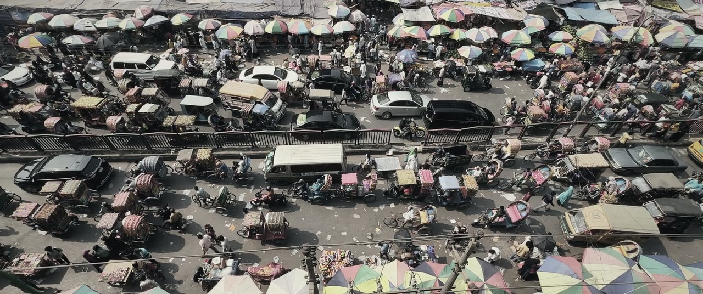
  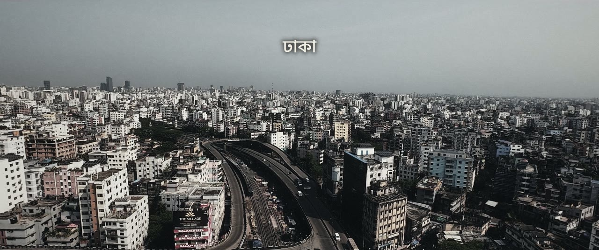
</p>
<p>
  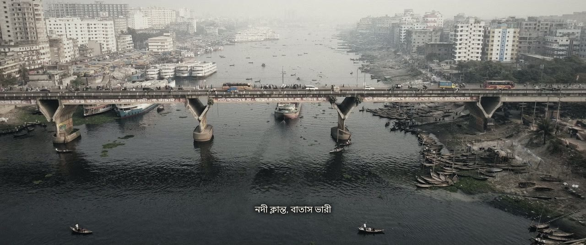
  
</p>

### II. আকাশনীড় — The garden · 0:51–1:46

A single bird call in the dark, then the title over doves in an open sky. A golden-hour walk into the
garden, and the facts land on the music's beats:
**৪১৮টি গাছ · ৫৮ প্রজাতি · প্রায় ১১,০০০ বর্গফুট**

<p>
  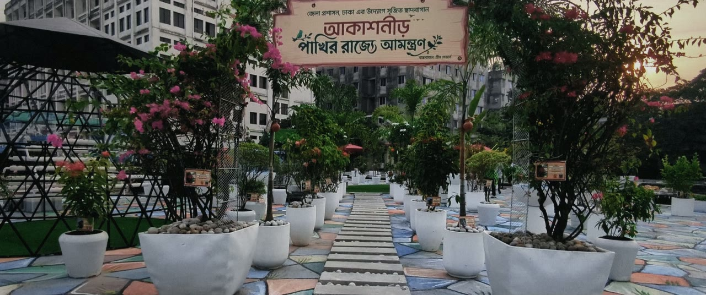
  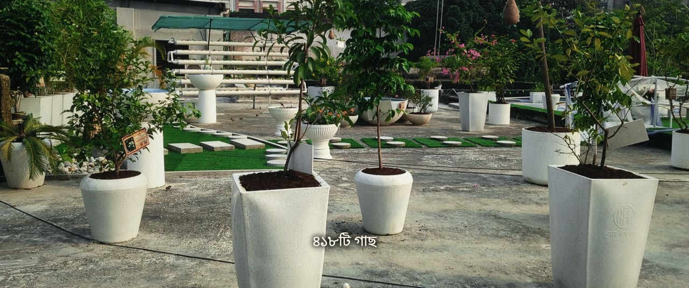
</p>

### III. প্রাণ ফেরে — Life returns · 1:46–2:43

**খাবারের ব্যবস্থা · পানির ব্যবস্থা · সবুজ আশ্রয়**. The gardener scatters feed and wild sparrows come down
to eat. Then the babui nests, a monkey among the canna flowers, a mongoose, cats, rabbits, and two wild
doves meeting on a branch: *প্রকৃতিকে জায়গা দিলে, প্রকৃতি ফিরে আসে*.

<p>
  
  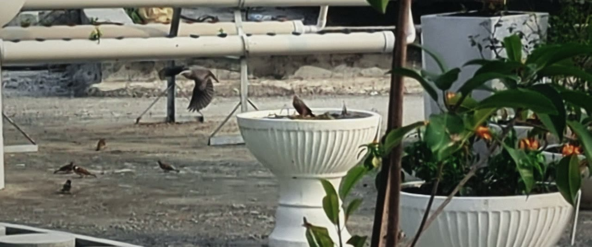
</p>
<p>
  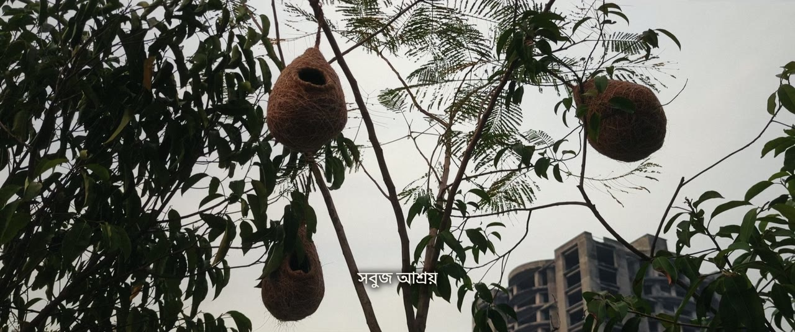
  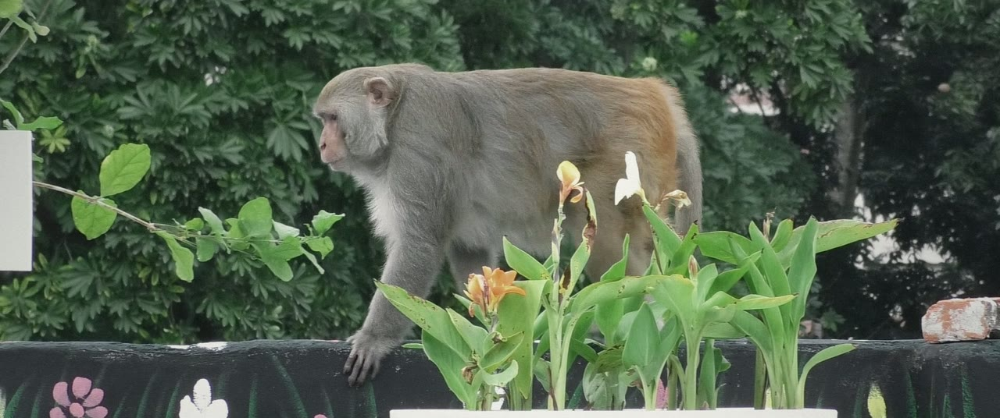
</p>

### IV. উদ্বোধন — The inauguration · 2:43–3:54

The score drops away and only birdsong remains. It returns as the plaque is unveiled, and peaks as
doves are released into the sky. The film ends where it began, over Dhaka:
*এই শহরের প্রতিটি ছাদ হতে পারে একটি আকাশনীড়*.

<p>
  
  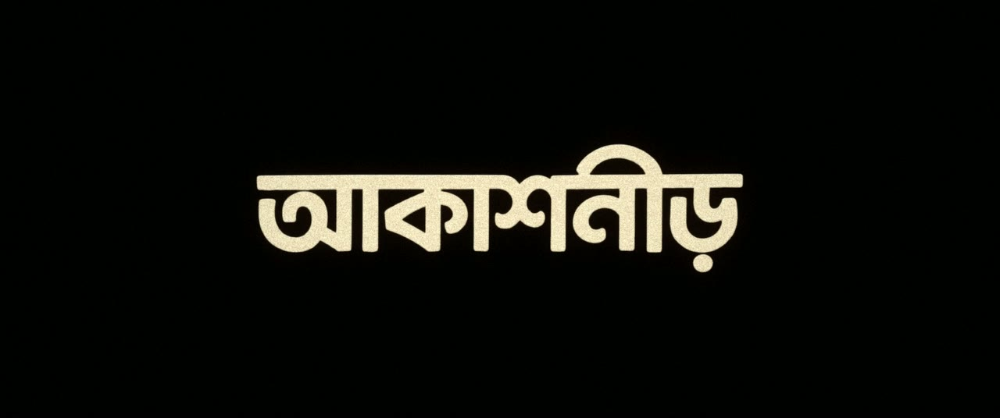
</p>

---

## The look

Three custom grading LUTs, one per part of the story, are in [`LUTs/`](LUTs) as 65-point and 33-point
`.cube` files (Rec.709 in / Rec.709 out). They work in DaVinci Resolve, Premiere Pro, Final Cut and
CapCut.

| LUT | Used for | Character |
|---|---|---|
| `AKASHNIR_01_Dhaka_Smog` | The city | Cold, drained colour, smoggy highlights, matte blacks |
| `AKASHNIR_02_Golden_Garden` | The garden, life returning | Warm highlights, emerald greens, tamed cyan and blue paint |
| `AKASHNIR_03_Hope` | The inauguration, the ending | Brighter, cleaner, warm |

Each clip is shot-matched first (exposure, white balance, contrast) and baked together with its act's
look into a per-clip LUT in [`_production/luts/clips/`](_production/luts/clips). The finishing pass
adds highlight halation, a soft vignette, film grain and the 2.39:1 letterbox. The title artwork carries
the same grain, so it sits inside the picture instead of on top of it.

Original (left) and graded (right):

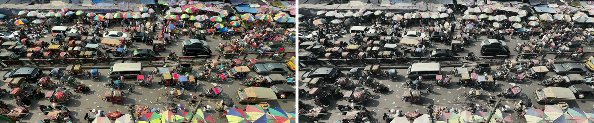
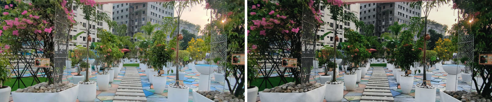


## Sound

There is no narration; the sound tells the story. City horns and crowds build into a riser and cut to
dead silence, and a single bird call opens the garden. The sound design uses ElevenLabs sound effects
(city, river, birds, wings, fountain, animals) and the cameras' own location audio (the wild sparrows,
the ceremony's applause). The score is by Scott Buckley. The mix is normalised to −15 LUFS.

## How it's built

The whole film is built by Python and FFmpeg scripts instead of an editing timeline, so every cut,
grade and sound placement is reproducible.

| Script | What it does |
|---|---|
| [`_production/edl.py`](_production/edl.py) | Edit decision list: every shot, in-point, speed, framing and all on-screen text. Cuts lock to the score's bar grid (4.363 s). |
| [`_production/render_shots.py`](_production/render_shots.py) | Renders each shot: slow-motion conform to 24 fps, 2.39:1 reframe, per-clip LUT, 10-bit intermediates. Skips shots that haven't changed. |
| [`_production/mix.py`](_production/mix.py) | Builds the sound mix sample-accurately from the edit, with two-pass loudness normalisation. |
| [`_production/final.py`](_production/final.py) | Bangla titles (libass with HarfBuzz shaping), title artwork, halation, vignette, grain, letterbox and the master encode. |
| [`_production/qc.py`](_production/qc.py) | Contact sheet at every story moment, plus stream and loudness checks. |

**Requirements:** FFmpeg 8 built with libass, libharfbuzz and libfribidi; Python 3.11+ with `numpy`,
`scipy`, `pillow` and `matplotlib`.

**Rebuilding the film:** the footage, music and rendered videos are not in this repository (see
[`.gitignore`](.gitignore)). Put the source clips in the repository root and the two music tracks in
`_production/music/`, then run:

```sh
cd _production
python render_shots.py   # graded shots
python mix.py            # sound mix
python final.py          # titles, finishing, master
python qc.py             # check sheet
```

## Repository layout

```text
.
├── LUTs/                    grading LUTs to use in any editor (65pt and 33pt)
├── docs/screenshots/        images used in this README
├── _production/
│   ├── edl.py               the edit
│   ├── render_shots.py      shot renderer
│   ├── mix.py               sound mix
│   ├── final.py             titles, finishing and master
│   ├── qc.py                quality check
│   ├── grade_cfg.json       per-clip grade settings
│   ├── luts/                act looks and per-clip LUTs
│   ├── sfx/                 sound effects
│   ├── fonts/               Google Sans
│   ├── stills/              reference frames and grade comparisons
│   └── text/                title assets
├── আকাশনীড় Bengali Title+.png            opening title artwork
├── Warm ivory Bengali title lettering.png   end card artwork
└── CREDITS_AND_NOTES.txt
```

## Credits

**পরিকল্পনা ও বাস্তবায়নে:** ফরিদা খানম, জেলা প্রশাসক ও জেলা ম্যাজিস্ট্রেট, ঢাকা
**ছাদবাগান বাস্তবায়নে:** গ্রীন সেভার্স
জেলা প্রশাসকের কার্যালয়, ঢাকা

- **Music:** "A Kind of Hope" and "Anabasis I" by Scott Buckley, released under
  [CC BY 4.0](https://creativecommons.org/licenses/by/4.0/) ·
  [scottbuckley.com.au](https://www.scottbuckley.com.au)
- **Sound effects:** ElevenLabs
- **Typeface:** Google Sans
